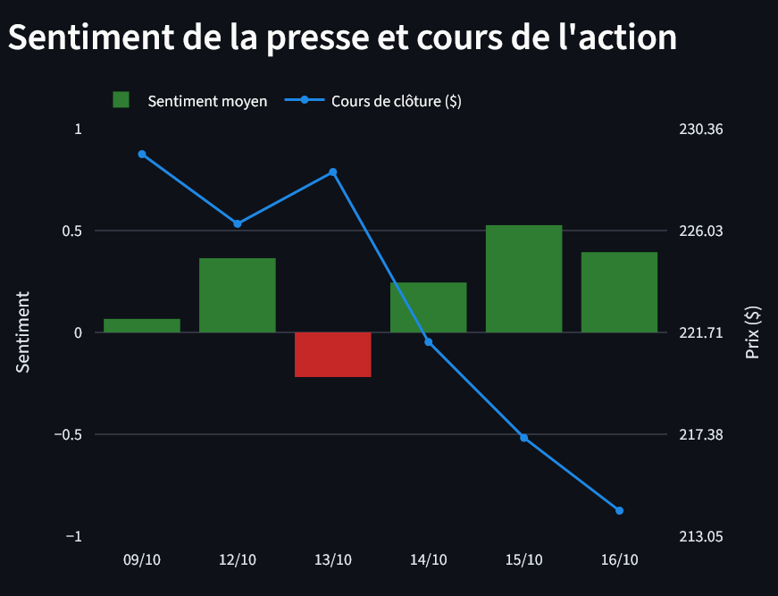

# 📰 NewsMood — Financial news sentiment vs stock prices

[](https://github.com/louchenilounes/newsmood/actions/workflows/tests.yml)
[](https://newsmood-lounes.streamlit.app)

**Does the tone of financial news say something about the stock price?**
NewsMood collects news about **Apple, Tesla and Nvidia** twice a day, measures their sentiment with two NLP models, and compares it with daily stock returns.

👉 **Try the live dashboard: [newsmood-lounes.streamlit.app](https://newsmood-lounes.streamlit.app)**



## Key results

**1. Choosing the model — with a fair evaluation**

| F1-score (macro) | Always "neutral" | TextBlob | FinBERT |
| --- | --- | --- | --- |
| Financial PhraseBank (seen by FinBERT during training) | 0.254 | 0.467 | 0.963 |
| **Twitter Financial News (never seen)** | **0.264** | **0.385** | **0.668** |

- FinBERT is clearly the best model on data it has never seen.
- **Data leakage:** FinBERT was trained on Financial PhraseBank, so its 0.96 score there is too optimistic. The honest number is 0.67.
- I use the **macro F1-score** because the classes are imbalanced (61–66% neutral texts).

**2. Data quality — 36% of the raw articles were not usable**

- Some news sites republish the same article under another URL → removed duplicates.
- The Yahoo "Nvidia" feed contained only 14% articles about Nvidia → kept only articles that mention the company.
- Seeking Alpha briefs all shared the same URL → gave each one a unique ID, so no headline is lost.

**3. Sentiment vs returns — provisional**

With 7 trading days (18 data points), no correlation is significant (Pearson r = −0.24, p = 0.35).
A power analysis shows that about **6 weeks of data** are needed to detect a correlation of 0.3. Data collection is still running.

## How it works

```
RSS feeds ──► newspaper4k ──► SQLite ──► TextBlob + FinBERT ──► pandas / statistics ──► Streamlit
                                 ▲
                yfinance (prices)
```

1. **Collection** (`src/collect.py`, `src/prices.py`): RSS feeds from Yahoo Finance, Nasdaq and Seeking Alpha, full text when available, quality filter, daily prices. Runs twice a day with the Windows Task Scheduler.
2. **Sentiment** (`src/sentiment.py`, `src/score.py`): TextBlob and FinBERT scores for every headline and full text.
3. **Cleaning and analysis** (`src/cleaning.py`, `src/analysis.py`): deduplication, relevance filter, each article linked to its trading day (New York time, after-close news moved to the next trading day).
4. **Notebooks**: `01_exploration`, `02_evaluation`, `03_analyse`.
5. **Dashboard** (`app.py`): overview, model comparison, and a "try it yourself" tab.

## Tech stack

Python · SQLite · pandas · scikit-learn · SciPy · Hugging Face Transformers (FinBERT) · TextBlob · Plotly · Streamlit · pytest · GitHub Actions

## Run it locally

```bash
git clone https://github.com/louchenilounes/newsmood.git
cd newsmood
python -m venv venv
venv\Scripts\activate              # Windows
pip install -r requirements.txt    # dashboard only
streamlit run app.py
```

Without a local database, the app uses the sample database `data/sample.db`.
For the full project (collection, notebooks, tests): `pip install -r requirements-dev.txt`, then `python -m src.update` and `python -m pytest`.

## Limits

- Short period of data for now (collection started in October 2026).
- FinBERT reads only the start of long articles (512 tokens) and gives one score per text, even when a news is good for one company and bad for another.
- Correlation does not mean causation: market news and earnings reports also move prices.